<div align="center">


# Creat_

**블로그를 만들고, 함께 쓰는 곳.**

회원이 블로그를 만들고 블로그장·부블로그장·멤버 역할로 다른 회원과 함께 운영하는 블로그 플랫폼

[](https://github.com/blogNM/blogproject/releases/tag/v1.5.0)
[](https://creat.java21.net)
[](https://github.com/blogNM/blogproject/blob/main/app/build.gradle)
[](https://github.com/blogNM/blogproject/blob/main/app/build.gradle)
[](https://github.com/blogNM/blogproject/blob/main/docs/05-guides/로컬-실행.md)
[](https://github.com/blogNM/blogproject/blob/main/specs/README.md)

[바로 써 보기](https://creat.java21.net) · [바뀐 것(CHANGELOG)](https://github.com/blogNM/blogproject/blob/main/CHANGELOG.md) · [릴리스](https://github.com/blogNM/blogproject/releases) · [설계 문서](https://github.com/blogNM/blogproject/blob/main/docs/README.md)

</div>

<p align="center">
  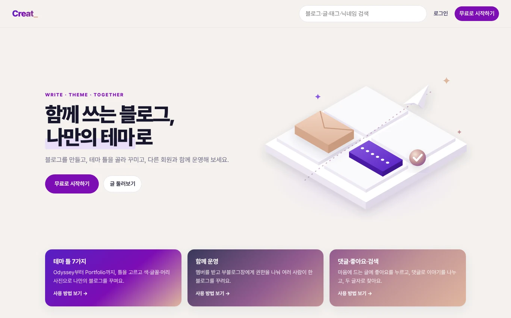
</p>

이름은 **Creat_** 입니다. 심플하지만 눈에 띄는 이름으로, 끝의 `_`는 글을 쓰는 커서처럼 복숭아색으로 깜빡입니다. 블로그 하나를 혼자 쓰는 대신, **블로그를 만들고 다른 회원을 멤버로 받아 함께 꾸리는 것**이 중심입니다. 한 회원이 A 블로그에서는 블로그장, B 블로그에서는 멤버일 수 있고, 서버는 요청마다 그 블로그에서의 역할을 DB로 다시 확인합니다. 화면은 보라·자주색과 따뜻한 흰 바탕, 직접 그린 SVG 그림으로 만들었습니다.

## 목차

- [한눈에 보기](#한눈에-보기)
- [한눈에 보는 흐름](#한눈에-보는-흐름)
- [빠르게 시작하기](#빠르게-시작하기)
- [주요 기능](#주요-기능)
- [아키텍처](#아키텍처)
- [저장소](#저장소)
- [직접 실행하기](#직접-실행하기)
- [기술 스택](#기술-스택)
- [개발 방식](#개발-방식)
- [릴리스](#릴리스)

## 한눈에 보기

| | Creat_ |
| --- | --- |
| 무엇 | 티스토리형 블로그 플랫폼. 메인 사이트에서 가입·로그인, 블로그 만들기·참여, 소셜, 전체 관리를 하고, 글은 각자 만든 블로그(`/blog/{주소}`)에서 씁니다 |
| 함께 운영 | 블로그장·부블로그장·멤버 역할, 자유·승인제 참여, 부블로그장 권한은 블로그장이 체크한 것만, 위임·폐쇄(7일 유예), 멤버 경고·정지·강제 퇴장 |
| 꾸미기 | 테마 틀 7가지(Odyssey·Poster·Whatever·Letter·Book Club·Magazine·Portfolio) + 강조 색·글꼴·머리 사진·문구, 공개·일부 공개·비공개 |
| 쓰기 | 보이는 그대로 쓰는 편집기(Toast UI), HTML 보기, 글자 색·크기·형광펜, 체크박스 목록, 사진, 태그, 링크 미리보기 카드 |
| 읽기 | 메인 피드(최신·인기·팔로우·구독), 블로그·글·태그·닉네임 통합 검색, 댓글·답글, 좋아요, 공유 미리보기(og 태그) |
| 소셜 | 팔로우, 블로그 구독, 차단, 신고, 알림(종류별 켜고 끄기), 내 활동·프로필 |
| 로그인 | 이메일 6자리 인증번호 가입, "로그인 유지", 구글·네이버·카카오 로그인 |
| 관리 | 회원과 분리된 관리자 계정으로 회원·블로그·글 관리, 신고 처리, 통계, 공지, 관리자 활동 기록 |
| 운영 | `main`에 합치면 GitHub Actions가 테스트 → Docker 이미지 → 학교 서버 배포(확인·되돌리기)까지 하고, 버전을 만들면 GitHub 릴리스와 사이트 공지에 같은 노트를 올립니다 |

## 한눈에 보는 흐름

### 글 하나가 쓰이고 읽히기까지

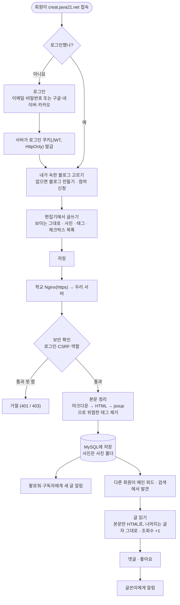

### 코드를 고치면 사이트에 올라가기까지

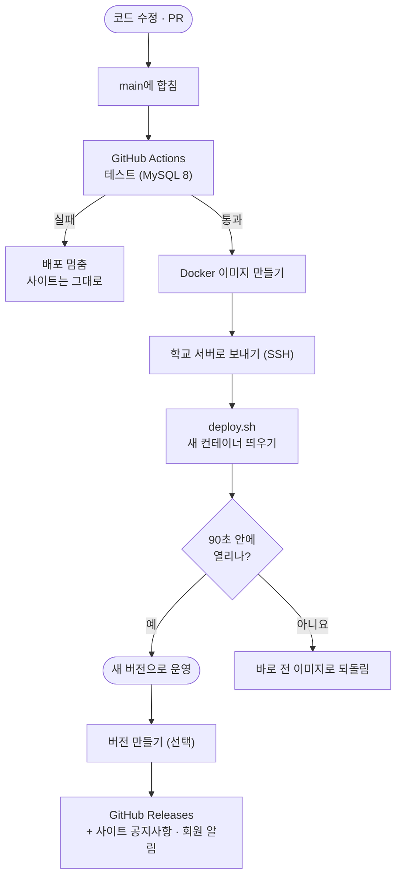

## 빠르게 시작하기

1. https://creat.java21.net 에서 **무료로 시작하기**를 누릅니다. 이메일로 받은 6자리 인증번호를 넣고 닉네임·비밀번호를 정하면 가입이 끝납니다. 구글·네이버·카카오로 로그인하면 닉네임과 약관 동의만 하면 됩니다.
2. 메인의 **블로그 만들기**에서 주소(`/blog/{주소}`), 공개 범위, 참여 방식(자유·승인제)을 정하고 테마 틀 7가지 중 하나를 고릅니다.
3. **글 작성하기**에서 내가 속한 블로그 중 하나를 골라 글을 씁니다. 쓰는 칸에 보이는 모양 그대로 올라갑니다.
4. 다른 블로그에는 **참여 신청하기**로 멤버가 되고, 마음에 드는 회원은 팔로우, 블로그는 구독하면 메인 피드와 알림으로 새 글을 받습니다.

> 화면 캡처와 함께 보는 사용 방법 6가지는 [creat.java21.net/guides](https://creat.java21.net/guides)에 있습니다.

## 주요 기능

<table>
<tr>
<td width="50%">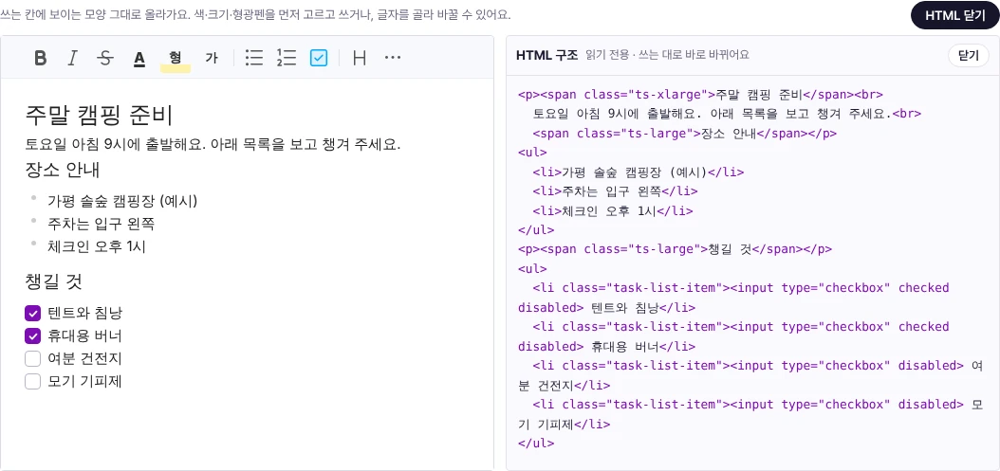<br/><b>글쓰기</b> — 보이는 그대로 쓰는 편집기, HTML 보기, 체크박스 목록</td>
<td width="50%">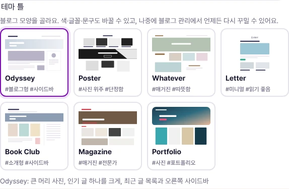<br/><b>블로그 만들기</b> — 테마 틀 7가지를 한눈에 고르고 색·글꼴·머리 사진으로 꾸미기</td>
</tr>
<tr>
<td width="50%">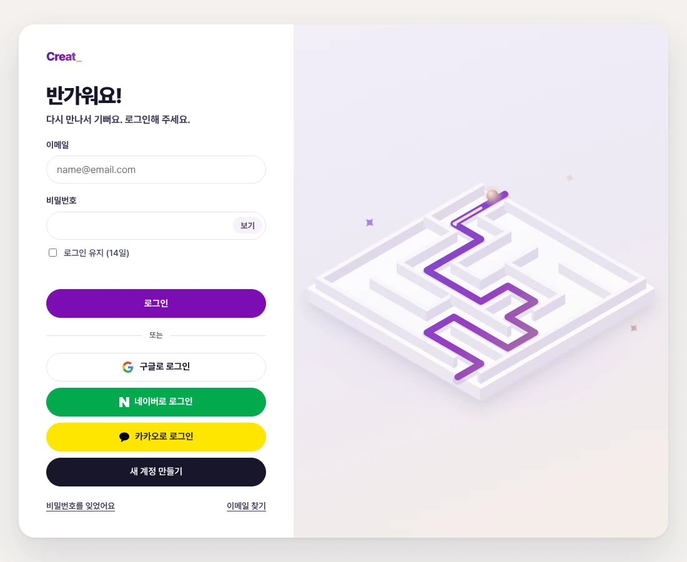<br/><b>로그인</b> — 로그인 유지(14일), 구글·네이버·카카오</td>
<td width="50%">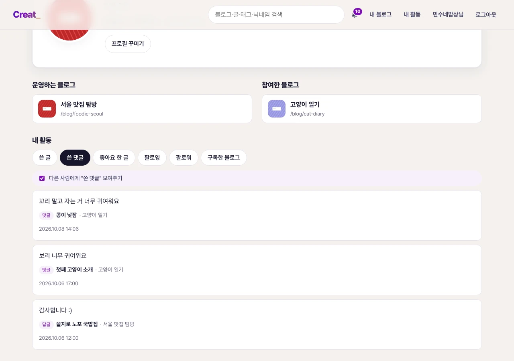<br/><b>내 활동</b> — 운영·참여한 블로그와 쓴 글·댓글·좋아요·팔로잉·구독, 목록마다 공개 설정</td>
</tr>
</table>

### 블로그 만들고 함께 운영하기

- **블로그 만들기** — 이름, 주소, 소개, 공개 범위(공개·일부 공개·비공개), 참여 방식(자유·승인제). 공개(일부 공개 포함)는 3개, 비공개는 5개까지 만들 수 있고, 이 숫자는 설정값으로 바꿉니다.
- **일부 공개** — 목록·검색·피드에는 나오지 않고, 블로그 주소와 따로 만든 공유 링크로만 들어옵니다. 링크를 새로 만들면 이전 링크는 막힙니다.
- **테마** — 테마 틀 7가지 중 하나에 강조 색·글꼴·머리 문구·머리 사진. 만들 때 고르고, 블로그 관리에서 언제든 다시 꾸밉니다.
- **역할** — 블로그장, 부블로그장, 멤버. 부블로그장은 블로그장이 체크한 권한(블로그 정보·테마 수정, 멤버 관리·제재·신고 처리, 글·카테고리 관리)만 가집니다.
- **참여와 떠나기** — 참여 신청·승인(거절되면 7일 뒤 다시 신청), 블로그 나가기, 블로그장 위임(받는 사람이 수락), 폐쇄(누른 날 + 7일 04:00, 그 사이 철회 가능, 멤버·구독자에게 알림).
- **블로그 안 제재** — 경고, 정지(3일·14일·30일·영구), 강제 퇴장. 강제 퇴장한 사람은 그 블로그의 블랙리스트에 해시로 남습니다. 멤버 표의 이름·이메일·전화번호는 가려서 보여 줍니다.

### 쓰기

- **보이는 그대로 쓰는 편집기** — Toast UI Editor로 글자 색 7가지, 글자 크기, 형광펜, 굵게·기울임·취소선, 제목, 목록(글머리·번호·체크박스), 인용, 구분선. 저장은 마크다운으로 합니다.
- **HTML 보기** — 편집기 옆(좁은 화면은 아래)에 글의 HTML 구조가 읽기 전용으로 보이고 쓰는 대로 바뀝니다.
- **블로그 골라 쓰기** — [글 작성하기]에서 내가 속한 블로그를 고르면 카테고리·공지 칸이 그 블로그 것으로 바뀌고, 쓰던 글은 남습니다.
- **사진** — jpg·jpeg·png·gif·webp, 한 장 3MB, 글 하나에 10장. 제목 30자, 본문 1,000자(사진·서식 표시는 세지 않음), 태그 10개까지.
- **링크 미리보기 카드** — 글에 링크만 한 줄 적으면 썸네일·제목·설명 카드로 보입니다. 저장할 때 서버가 한 번 받아 둡니다.

### 읽기와 찾기

<p align="center">
  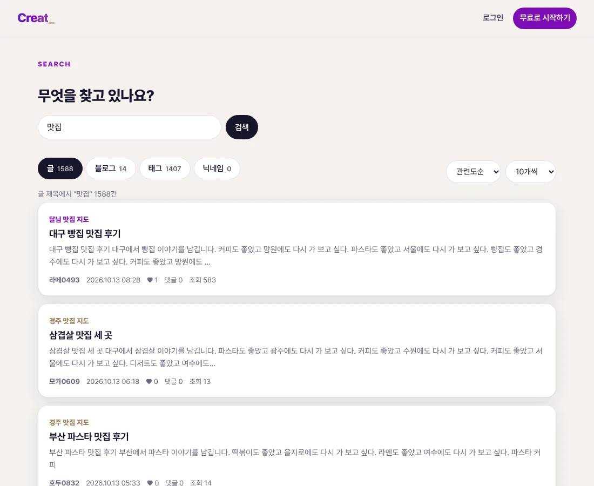
</p>

- **메인 피드** — 최신 글, 인기 글, 팔로우한 회원의 글, 구독한 블로그의 글. 메인 오른쪽에는 공지사항과 새로 생긴 블로그.
- **통합 검색** — 블로그·글·태그·닉네임을 한 번에, 관련도순·최신순·인기순. MySQL FULLTEXT + ngram이라 두 글자로도 찾습니다.
- **댓글·좋아요** — 댓글과 답글, 좋아요를 누르면 하트가 톡 커집니다. 댓글은 고치면 "수정됨"이 붙습니다.
- **공유 미리보기** — 사이트·블로그·글 주소를 카톡 등에 보내면 제목과 그림이 나옵니다. 머리 사진이 없는 블로그는 테마 틀·강조 색으로 그린 그림(`/blog/{주소}/og-image.png`)을 씁니다.

### 소셜과 알림

- **팔로우·구독** — 회원은 팔로우, 블로그는 구독. 다시 누르면 취소합니다.
- **차단** — 차단한 회원의 글과 댓글을 숨기고 서로의 팔로우를 끊습니다.
- **신고** — 회원·블로그·글·댓글을 사유를 골라 신고합니다. 블로그 안의 일은 블로그장이, 블로그 자체와 블로그장에 대한 신고는 메인 관리자가 처리합니다.
- **알림** — 종 아이콘에서 보고, 읽음·전체 삭제, 내 정보에서 종류별로 켜고 끕니다. 30초마다 새 알림을 확인합니다.
- **내 활동·프로필** — 쓴 글, 쓴 댓글, 좋아요 한 글, 팔로잉, 구독을 탭으로 보고, 목록마다 다른 사람에게 보여 줄지 고릅니다.

### 계정과 관리

- **회원 가입** — 이메일 6자리 인증번호(10분, 1분에 한 번 다시 보내기, 5번 틀리면 무효), 가입 화면의 이메일 중복 확인.
- **로그인** — "로그인 유지"를 켜면 14일, 끄면 30분 동안 아무것도 안 하거나 브라우저를 닫으면 로그아웃. 3번 틀리면 사람 확인(Cloudflare Turnstile), 5번 틀리면 5분 잠금.
- **소셜 로그인** — 구글·네이버·카카오. 같은 이메일 회원이면 연결해 로그인하고, 처음 온 사람은 닉네임·약관 동의만으로 가입합니다. 구글·카카오는 매번 계정 고르기 화면을 띄웁니다.
- **찾기·탈퇴** — 비밀번호 찾기·이메일 찾기(결과는 가려서), 내 정보 수정, 탈퇴(탈퇴하면 소셜 연결도 끊김).
- **메인 관리자** — 회원과 분리된 관리자 계정. 회원·블로그(숨김·강제 폐쇄)·글·댓글 관리, 신고 처리, 통계, 공지 쓰기, 관리자 활동 기록.

## 아키텍처

Creat_는 **Spring Boot 서버 하나**가 화면 파일(정적 HTML + JS)과 API를 함께 내보내는 구조입니다. 기능은 패키지로 나누고, 블로그별 역할 확인·XSS·CSRF처럼 모든 기능에 걸리는 규칙은 [헌법](https://github.com/blogNM/blogproject/blob/main/.specify/memory/constitution.md)에 모아 한 곳에서 처리합니다. 나중에 서버를 늘릴 수 있도록 로그인은 쿠키(JWT)에 담고, 인증번호·횟수 같은 값은 서버 메모리가 아니라 DB에 둡니다.

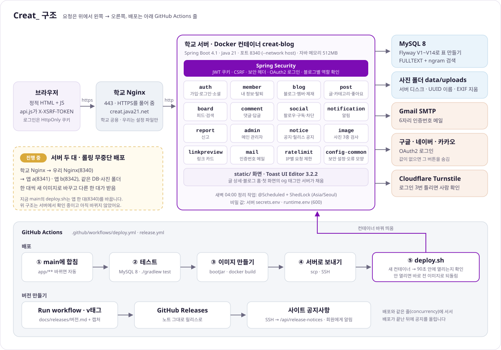

### 패키지

`app/src/main/java/com/blognm/mainblog/` 아래 기능별 패키지입니다.

| 패키지 | 하는 일 | 명세 |
| --- | --- | --- |
| **auth** | 회원 가입(이메일 인증번호), 로그인·로그아웃·토큰 갱신, 비밀번호·이메일 찾기, 구글·네이버·카카오 로그인, 사람 확인 | [001](https://github.com/blogNM/blogproject/blob/main/specs/001-member-account/spec.md) |
| **member** | 내 정보(닉네임·전화번호·비밀번호), 탈퇴 | 001 |
| **blog** | 블로그 만들기·테마·공개 범위, 참여 신청·승인, 블로그별 역할 확인(`BlogAuth`), 위임·폐쇄, 경고·정지·강제 퇴장, 공유 그림 | [002](https://github.com/blogNM/blogproject/blob/main/specs/002-blog-management/spec.md) |
| **post** | 글 쓰기·읽기·수정·삭제, 카테고리, 좋아요, 마크다운 → HTML 변환과 거르기(`MarkdownRenderer`), 글 상세 og 태그 | [004](https://github.com/blogNM/blogproject/blob/main/specs/004-board/spec.md) |
| **board** | 메인 피드, 통합 검색, 최근 검색어 | 004 |
| **comment** | 댓글·답글 | 004 |
| **image** | 사진 올리기(세 겹 검사), 디스크 저장(`FileStorage`), EXIF 지우기 | 004 |
| **linkpreview** | 링크 미리보기 카드, 내부망 주소는 받지 않음 | 004 |
| **social** | 팔로우·구독·차단, 프로필, 내 활동 공개 설정 | [003](https://github.com/blogNM/blogproject/blob/main/specs/003-social-notification/spec.md) |
| **notification** | 알림, 종류별 설정, 지난 알림 정리 | 003 |
| **report** | 신고 접수와 처리 | 003, 005 |
| **admin** | 관리자 계정, 회원·블로그·글 관리, 통계, 활동 기록 | [005](https://github.com/blogNM/blogproject/blob/main/specs/005-admin-moderation/spec.md) |
| **notice** | 공지사항, 사용 방법 안내, 릴리스 공지 받기 | 005 |
| **mail** | 인증번호 메일(Gmail SMTP, 개발 때는 콘솔) | 001 |
| **ratelimit** | IP별 요청 제한 | 001 |
| **config · common** | 보안 설정, CSRF, 정적 파일 캐시, 공통 오류 모양, 개인정보 가림, 첫 화면 og 태그 | 헌법 |

DB 표는 Flyway 마이그레이션(`V1`~`V14`)으로만 만들고, JPA는 표가 맞는지 확인(`validate`)만 합니다. 새벽 정리 작업은 `@Scheduled(zone = "Asia/Seoul")`에 ShedLock을 걸어 서버가 여러 대여도 한 번만 돕니다.

### 요청 흐름

**로그인과 API 호출** — 서버 세션 대신 JWT를 HttpOnly 쿠키에 담습니다. Access Token은 5분, 만료되면 `api.js`가 Refresh Token으로 한 번 갱신하고 원래 요청을 다시 보냅니다. 토큰에는 회원 번호 정도만 담고, 블로그별 역할은 매 요청 DB에서 확인합니다.

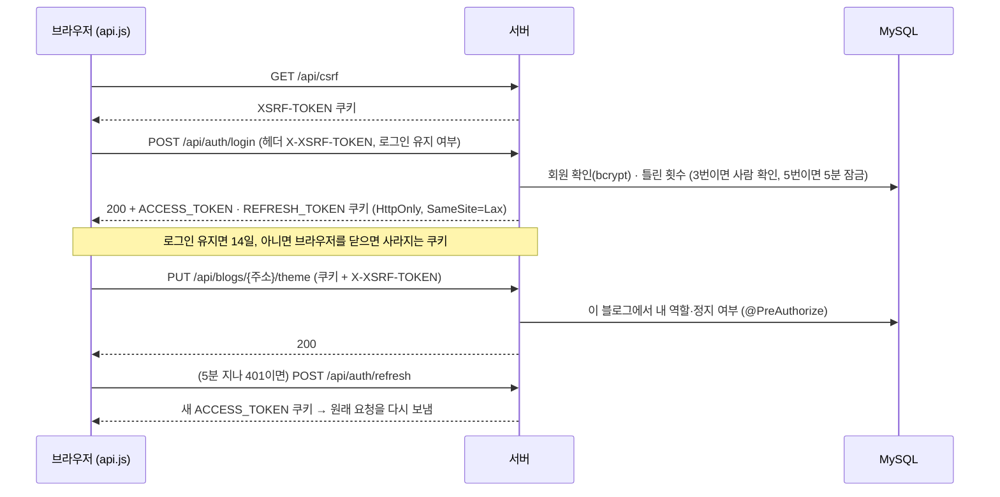

**소셜 로그인** — 구글·네이버·카카오 모두 같은 흐름입니다. 회사가 확인한 이메일만 쓰고, 로그인을 마치면 이메일 로그인과 같은 토큰 쿠키를 내려줍니다.

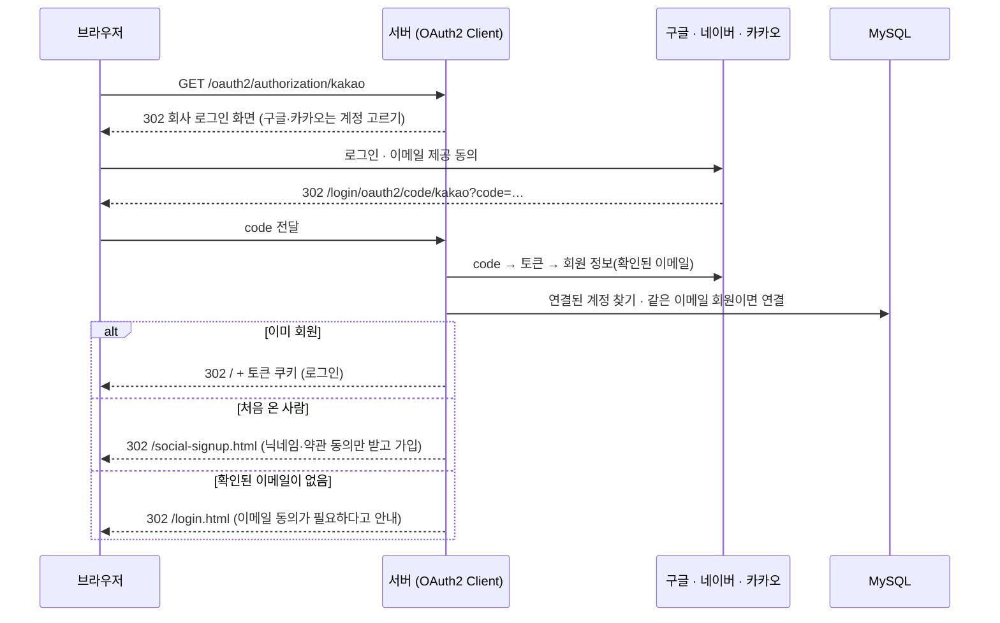

**글 쓰고 읽기** — 본문은 마크다운으로 저장하고, 읽을 때 서버가 HTML로 바꾼 뒤 jsoup으로 거릅니다. 화면이 `innerHTML`로 넣는 것은 이 본문 하나뿐이고, 닉네임·댓글·태그는 모두 `textContent`로 넣습니다.

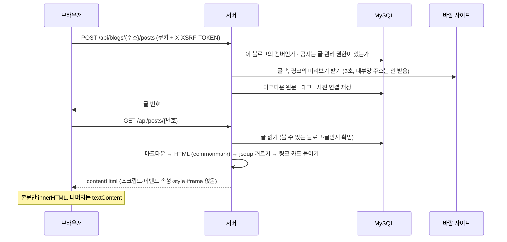

### 보안과 데이터 보호

- **비밀번호** — bcrypt로만 저장합니다. 인증번호와 임시 토큰도 해시로 두고, 만료·횟수 제한이 있으며 쓰거나 만료되면 지웁니다.
- **로그인 쿠키** — 토큰은 HttpOnly·Secure·SameSite=Lax 쿠키에만 담고 localStorage에는 두지 않습니다.
- **CSRF** — 상태를 바꾸는 요청은 모두 쿠키 `XSRF-TOKEN` + 헤더 `X-XSRF-TOKEN`이 있어야 합니다. 헤더는 공통 `api.js` 한 곳에서 붙입니다.
- **보안 헤더** — Spring Security로 X-Frame-Options(DENY), X-Content-Type-Options(nosniff), Content-Security-Policy, Strict-Transport-Security, Referrer-Policy. 에디터·글꼴도 바깥 CDN 대신 서버에 둡니다.
- **권한은 서버가** — 블로그별 역할과 정지·강퇴 여부를 요청마다 DB로 확인합니다. 블로그장과 관리자도 남의 글은 고칠 수 없습니다.
- **글 본문** — 링크는 http·https·mailto만, 그림은 이 사이트에 올린 사진만 남깁니다. 체크박스는 누를 수 없는 것(`disabled`)만 남깁니다.
- **사진 올리기** — 확장자·MIME·파일 시그니처를 모두 확인하고, UUID 이름으로 저장하며 EXIF(GPS 등)를 지웁니다.
- **개인정보 가림** — 이메일·전화번호 가림은 화면이 아니라 서버가 응답을 만들 때 합니다. 관리자가 "전체 보기"를 누르면 누가 언제 봤는지 남깁니다.
- **매크로 막기** — 계정별 로그인 잠금 + IP별 요청 제한. IP별 횟수는 지금 서버 메모리에서 세고 있어, 서버를 늘리기 전에 저장 위치를 정해야 합니다(확인 필요 항목으로 남겨 둠).
- **비밀 값** — DB·메일·소셜 로그인 열쇠는 저장소에 없습니다. GitHub Secrets → 배포 때 서버의 `runtime.env`로, JWT 서명 키는 서버에서 처음 한 번 만든 `secrets.env`에 둡니다(두 파일 모두 권한 600).

### 배포

`main`에 `app/` 변경이 들어오면 GitHub Actions의 **배포** 작업이 ① MySQL 8을 띄워 `./gradlew test`를 돌리고 ② `bootJar`와 `Dockerfile`로 `creat-blog` 이미지를 만들어 ③ SSH로 학교 서버에 보낸 뒤 ④ [`deploy.sh`](https://github.com/blogNM/blogproject/blob/main/app/deploy/deploy.sh)가 컨테이너를 새로 띄웁니다. 90초 안에 사이트가 열리지 않으면 로그를 보여 주고 바로 전 이미지로 되돌립니다. HTTPS는 학교 공용 Nginx가 풀어 주고, 앱 컨테이너는 서버 포트 8340에서 받습니다. 자세한 내용은 [도커 배포 안내](https://github.com/blogNM/blogproject/blob/main/docs/05-guides/도커-배포.md)에 있습니다.

> **진행 중 — 서버 두 대·롤링 무중단 배포.** 지금은 배포할 때마다 컨테이너를 바꾸는 몇 초 동안 사이트가 멈춥니다. 학교 Nginx → 우리 Nginx(8340) → 앱 두 대(8341·8342) 구조로 바꾸고, 한 대씩 새 이미지로 바꾸는 동안 다른 한 대가 요청을 받게 하는 작업을 서버에서 확인하고 있습니다. 아직 `main`의 배포 방식은 앱 한 대입니다.

## 저장소

코드와 문서를 저장소 하나에 두고, 폴더로 나눕니다. 서버에는 `app/` 폴더만 씁니다.

| 저장소 · 폴더 | 설명 |
| --- | --- |
| [blogproject](https://github.com/blogNM/blogproject) | **코드와 문서** 전체 |
| ├ [`app/`](https://github.com/blogNM/blogproject/blob/main/app/README.md) | Spring Boot Gradle 프로젝트 — 서버 코드, 화면(`static/`), DB 마이그레이션, 테스트, 테스트 데이터 스크립트, `Dockerfile`, `deploy/deploy.sh` |
| ├ [`docs/`](https://github.com/blogNM/blogproject/blob/main/docs/README.md) | 요구사항분석서 원본(PDF), [결정 기록](https://github.com/blogNM/blogproject/blob/main/docs/03-decisions/README.md)(D-번호), [ERD](https://github.com/blogNM/blogproject/blob/main/docs/04-design/ERD.md), [안내서](https://github.com/blogNM/blogproject/blob/main/docs/05-guides/README.md), [릴리스 노트](https://github.com/blogNM/blogproject/blob/main/docs/releases/v1.5.0.md) |
| ├ [`specs/`](https://github.com/blogNM/blogproject/blob/main/specs/README.md) · [`.specify/`](https://github.com/blogNM/blogproject/blob/main/.specify/memory/constitution.md) | Spec Kit 기능 명세 5개(spec·plan·tasks)와 프로젝트 헌법 |
| ├ [`.github/workflows/`](https://github.com/blogNM/blogproject/blob/main/.github/workflows/deploy.yml) | 배포, 버전 만들기, 서버 상태 확인 |
| └ [`CHANGELOG.md`](https://github.com/blogNM/blogproject/blob/main/CHANGELOG.md) · [`CLAUDE.md`](https://github.com/blogNM/blogproject/blob/main/CLAUDE.md) | 변경 기록, 에이전트 작업 규칙 |

## 직접 실행하기

### 준비물

| 도구 | 버전 | 쓰는 곳 |
| --- | --- | --- |
| Java (JDK) | 21 | 서버 빌드·실행·테스트 |
| MySQL | 8.0 이상 | `blog`(개발), `blog_test`(자동 테스트) |
| Gradle | 따로 설치 안 함 | `app/gradlew`가 알아서 받습니다 |

### 로컬 포트

| 무엇 | 주소 | 비고 |
| --- | --- | --- |
| 서버 + 화면 (Spring Boot) | http://localhost:8080 | 정적 화면과 `/api`를 한 서버가 내보냅니다 |
| 관리자 화면 | http://localhost:8080/admin/login.html | 회원과 분리된 관리자 계정 (첫 관리자는 `ADMIN_INITIAL_LOGIN_ID`·`ADMIN_INITIAL_PASSWORD`) |
| MySQL | localhost:3306 | 표는 서버가 처음 뜰 때 Flyway가 만듭니다 |

### 실행

```bash
git clone https://github.com/blogNM/blogproject && cd blogproject/app

# 처음 한 번: DB와 계정
mysql -uroot <<'SQL'
CREATE DATABASE blog CHARACTER SET utf8mb4 COLLATE utf8mb4_0900_ai_ci;
CREATE DATABASE blog_test CHARACTER SET utf8mb4 COLLATE utf8mb4_0900_ai_ci;
CREATE USER 'blog'@'localhost' IDENTIFIED BY 'blog';
GRANT ALL ON blog.* TO 'blog'@'localhost';
GRANT ALL ON blog_test.* TO 'blog'@'localhost';
SQL

./gradlew bootRun --args='--spring.profiles.active=local'   # http://localhost:8080
./gradlew test                                              # 자동 테스트 (blog_test 사용)
```

- `local` 프로필은 메일을 보내지 않고 **서버 콘솔에 인증번호를 찍습니다.** 실제 Gmail로 받으려면 `MAIL_MODE=smtp MAIL_USERNAME=… MAIL_PASSWORD=앱비밀번호`를 넣습니다.
- 사람 확인(Turnstile)은 기본값으로 Cloudflare의 "항상 통과" 테스트 키를 씁니다.
- 구글·네이버·카카오 로그인은 `GOOGLE_CLIENT_ID`·`NAVER_CLIENT_ID`·`KAKAO_CLIENT_ID`(와 각 SECRET)를 넣었을 때만 버튼이 보입니다.
- 회원 10명·블로그 5개가 들어 있는 테스트 데이터는 `app/scripts/test-data/load.sh`로 넣습니다(지금 DB를 백업한 뒤 모두 바꿈). [테스트 데이터 안내](https://github.com/blogNM/blogproject/blob/main/docs/05-guides/테스트-데이터.md)
- 단계별로 직접 눌러 볼 목록은 [로컬 실행 안내](https://github.com/blogNM/blogproject/blob/main/docs/05-guides/로컬-실행.md)에 있습니다.

## 기술 스택

### 서버

| 기술 | 버전 | 쓰는 이유 |
| --- | --- | --- |
| Java | 21 | LTS. Gradle 툴체인으로 고정 |
| Spring Boot | 4.1.1 | 웹(MVC), 검증, 메일, JPA, Flyway를 한 버전 묶음으로 |
| Spring Security | Boot 버전 따름 | JWT 쿠키 로그인, CSRF, 보안 헤더, `@PreAuthorize`로 블로그별 역할 확인 |
| Spring Security OAuth2 Client | Boot 버전 따름 | 구글·네이버·카카오 로그인. 값이 없으면 그 버튼을 숨기고 서버는 그대로 뜹니다 |
| jjwt | 0.13.0 | Access·Refresh Token 만들기와 확인 |
| Spring Data JPA · Flyway | Boot 버전 따름 | 표는 Flyway 마이그레이션(`V1`~`V14`)으로만 만들고, JPA는 `validate`만 |
| MySQL | 8 | 기본 저장소. 검색은 FULLTEXT + ngram으로 두 글자부터 |
| commonmark | 0.24.0 | 글 본문 마크다운 → HTML (표, 취소선, 자동 링크, 체크박스 목록) |
| jsoup | 1.18.3 | 바꾼 HTML에서 허용한 태그·class만 남기기 (XSS) |
| ShedLock | 7.10.1 | 새벽 04:00 정리 작업이 서버가 여러 대여도 한 번만 돌게 |
| Spring Mail (Gmail SMTP) | Boot 버전 따름 | 6자리 인증번호를 서버가 직접 보내고 확인 |

### 화면

| 기술 | 버전 | 쓰는 이유 |
| --- | --- | --- |
| 정적 HTML + JS (ES 모듈) | — | 빌드 도구 없이 서버가 그대로 내보냄. 글 상세·블로그 홈·첫 화면의 og 태그만 서버가 채움 |
| `api.js` | — | 모든 요청이 거치는 한 곳. CSRF 헤더, 토큰 갱신, 30분 무활동 로그아웃, 5초 시간 제한 |
| Toast UI Editor | 3.2.2 | 보이는 그대로 쓰는 편집기. CSP `script-src 'self'`를 지키려고 서버에 한 파일로 둠 |
| Pretendard | 1.3.9 | 화면 글꼴(OFL). 바깥 CDN 없이 서버에 둠 |
| 직접 그린 SVG | — | 첫 화면·로그인·가입·404·빈 화면 그림. 동작 줄이기를 켜면 멈춤 |
| Cloudflare Turnstile | — | 로그인 3번 틀리면 사람 확인 |

### 품질과 운영

| 기술 | 역할 |
| --- | --- |
| JUnit 5 · Spring Boot Test · Spring Security Test | 서버 테스트 파일 28개. 실제 MySQL(`blog_test`)로 돌립니다 |
| GitHub Actions | 배포(테스트 → 이미지 → 서버), 버전 만들기(GitHub 릴리스 + 사이트 공지), 서버 상태 확인 |
| Docker | `eclipse-temurin:21-jre` 이미지 하나, 자바 메모리 512MB |
| Nginx | 학교 공용 Nginx가 HTTPS를 풀어 앱으로 넘김. 서버 두 대 구성은 진행 중 |

## 개발 방식

- **명세부터** — 요구사항분석서(2026-10-02)를 [GitHub Spec Kit](https://github.com/blogNM/blogproject/blob/main/specs/README.md) 형식으로 옮겨 기능마다 `specs/00N-*/`에 spec → plan → tasks를 씁니다. 요구사항 ID는 원래 이름을 그대로 씁니다(USR→001, BLG→002, SOC→003, BRD→004, ADM→005).
- **결정은 D-번호로** — 정한 것은 [`docs/03-decisions/`](https://github.com/blogNM/blogproject/blob/main/docs/03-decisions/README.md)에 한 건씩 남기고(D-01~81은 PDF 8장, D-82부터 파일), 관련 spec의 Clarifications에도 한 줄 적습니다. 정해지지 않은 항목은 `[NEEDS CLARIFICATION]`으로 두고 임의로 정하지 않습니다.
- **헌법** — 블로그별 역할 확인, XSS·CSRF, 개인정보, 서버 이중화 대비, 설정값, 업로드 검사, 1차 범위를 [원칙 I~VIII](https://github.com/blogNM/blogproject/blob/main/.specify/memory/constitution.md)로 묶고 `/speckit-plan`이 계획마다 확인합니다.
- **브랜치와 PR** — `main`은 서버로 자동 배포되므로 직접 고치지 않습니다. 고칠 거리마다 브랜치에서 PR을 열고, 같은 PR에 [CHANGELOG](https://github.com/blogNM/blogproject/blob/main/CHANGELOG.md) 항목을 넣습니다. 작은 문구·버튼 하나도 남깁니다.
- **바뀔 숫자는 설정으로** — 블로그 개수, 사진 크기, 인증번호 시간 같은 값은 `application.yml` + 환경변수로 둡니다. 예: `blog.limit.public=${BLOG_LIMIT_PUBLIC:3}`.

## 릴리스

버전을 낼 때는 Actions의 **버전 만들기**를 돌립니다. `docs/releases/<버전>.md` 노트와 캡처가 GitHub 릴리스와 사이트 공지사항에 같이 올라가고, 회원에게 공지 알림이 갑니다. 기능이 늘면 가운데 숫자, 고치기만 했으면 끝 숫자를 올립니다. [릴리스 노트 쓰는 법](https://github.com/blogNM/blogproject/blob/main/docs/05-guides/릴리스-노트.md)

| 버전 | 날짜 | 주요 내용 | 기록 |
| --- | --- | --- | --- |
| v1.6.0 | 준비 중 | 서버 두 대·롤링 무중단 배포 확인 (진행 중) | — |
| v1.5.0 | 2026-10-14 | 체크박스 목록, 글자 크기를 키워도 굵어지지 않게 | [보기](https://github.com/blogNM/blogproject/releases/tag/v1.5.0) |
| v1.4.1 | 2026-10-13 | 새로고침 약 6배, 검색 최대 10배 빨라짐 | [보기](https://github.com/blogNM/blogproject/releases/tag/v1.4.1) |
| v1.4.0 | 2026-10-13 | 네이버·카카오 로그인, 다른 카카오·구글 계정으로 로그인 | [보기](https://github.com/blogNM/blogproject/releases/tag/v1.4.0) |
| v1.3.0 | 2026-10-13 | 보이는 그대로 쓰는 편집기, HTML 보기, 줄바꿈 | [보기](https://github.com/blogNM/blogproject/releases/tag/v1.3.0) |
| v1.2.0 | 2026-10-13 | 사용 방법 안내(`/guides`), 움직이는 그림 | [보기](https://github.com/blogNM/blogproject/releases/tag/v1.2.0) |
| v1.1.0 | 2026-10-13 | 구글 로그인 | [보기](https://github.com/blogNM/blogproject/releases/tag/v1.1.0) |
| v1.0.5 | 2026-10-13 | 테마 틀 한눈에 고르기 | [보기](https://github.com/blogNM/blogproject/releases/tag/v1.0.5) |
| v1.0.4 | 2026-10-12 | 만들 때 테마 고르기, 블로그 골라 글쓰기 | [보기](https://github.com/blogNM/blogproject/releases/tag/v1.0.4) |
| v1.0.3 | 2026-10-12 | 사이트·블로그·글 공유 미리보기 | [보기](https://github.com/blogNM/blogproject/releases/tag/v1.0.3) |
| v1.0.2 | 2026-10-12 | 이용약관·개인정보 처리방침 | [보기](https://github.com/blogNM/blogproject/releases/tag/v1.0.2) |
| v1.0.1 | 2026-10-12 | 인증 메일 고침, 공지 카테고리, 가입 화면 이메일 중복 확인 | [보기](https://github.com/blogNM/blogproject/releases/tag/v1.0.1) |
| v1.0.0 | 2026-10-12 | 첫 버전: 가입·로그인, 블로그 만들기·함께 쓰기, 글쓰기, 댓글·좋아요·검색, 팔로우·구독·알림 | [보기](https://github.com/blogNM/blogproject/releases/tag/v1.0.0) |

---

<div align="center">

**Creat_** · [creat.java21.net](https://creat.java21.net) · 화면 글꼴 [Pretendard](https://github.com/blogNM/blogproject/blob/main/app/src/main/resources/static/vendor/pretendard/README.md) · 편집기 [Toast UI Editor](https://github.com/blogNM/blogproject/blob/main/app/src/main/resources/static/vendor/toastui/README.md)

</div>
